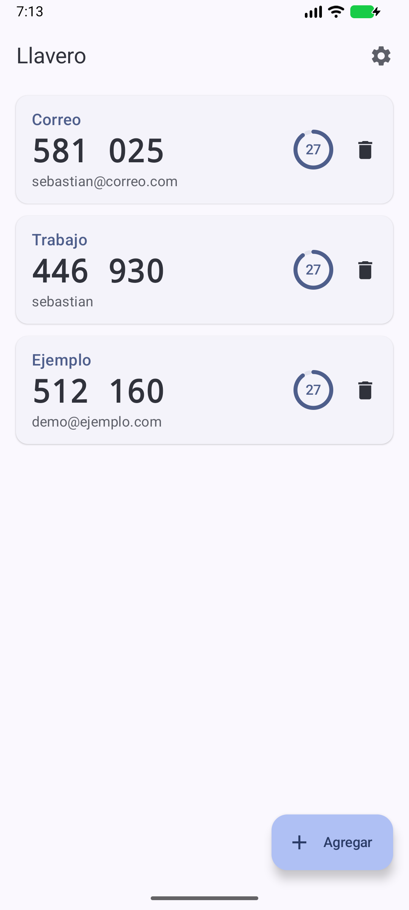
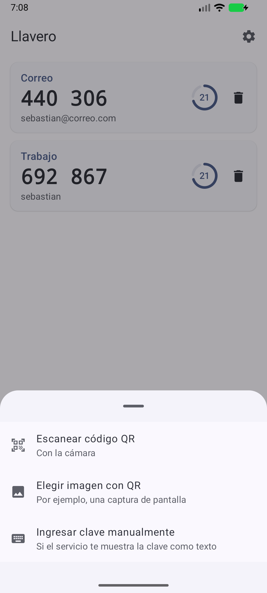
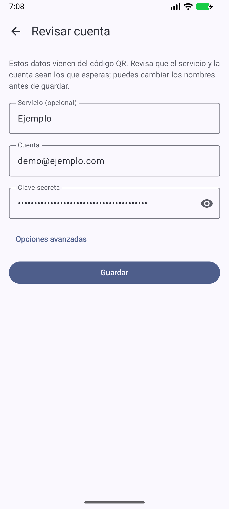
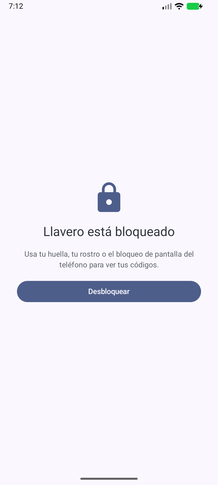
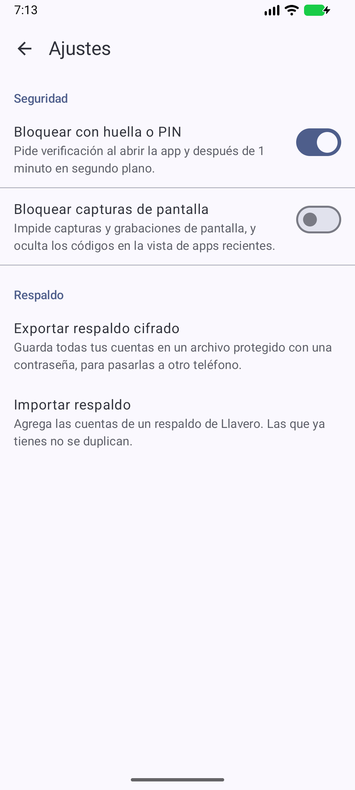

# Llavero

Autenticador de dos factores (TOTP) para Android, hecho con Kotlin y Jetpack Compose y diseñado con la seguridad como requisito, no como añadido. Funciona sin internet: la app ni siquiera pide ese permiso.

[](https://github.com/SebastianCastellanos123/llavero/actions/workflows/ci.yml)

| Códigos | Agregar | Revisar un QR | Bloqueo | Ajustes |
|---|---|---|---|---|
|  |  |  |  |  |

Las capturas son de cuentas de ejemplo.

## Qué hace

- Genera códigos TOTP (RFC 6238) con SHA1, SHA256 o SHA512, de 6 a 8 dígitos, con cuenta regresiva.
- Agrega cuentas escaneando el QR con la cámara, desde una imagen (por ejemplo, una captura) o escribiendo la clave.
- Guarda las cuentas cifradas con una clave de Android Keystore.
- Se bloquea con huella, rostro o el PIN del teléfono.
- Exporta e importa un respaldo cifrado con contraseña, para pasar las cuentas a otro teléfono.

## Decisiones de seguridad

| Riesgo | Cómo lo enfrenta Llavero |
|---|---|
| Que los secretos salgan por la red | La app no pide el permiso `INTERNET`. Una prueba instrumentada revisa el manifiesto final (mezclado con el de todas las librerías) y falla si aparece cualquier permiso no aprobado. |
| Que alguien copie el archivo de cuentas | AES-256-GCM con una clave que no sale de Android Keystore (en StrongBox si el teléfono lo tiene). El archivo copiado a otro dispositivo no sirve. |
| Que alguien altere el archivo de cuentas | GCM autentica los datos y el encabezado va como AAD. Una prueba cambia cada byte del archivo, uno por uno, y comprueba que siempre se detecta. |
| Que una copia de seguridad de Android saque los datos | `allowBackup="false"` y reglas que excluyen todo, también la transferencia directa entre teléfonos (que `allowBackup` no cubre desde Android 12). |
| Un QR malicioso | El enlace `otpauth://` se trata como entrada no confiable: se rechazan parámetros repetidos y escapes mal formados, y nada se guarda sin que el usuario revise los datos. |
| Alguien con el teléfono desbloqueado en la mano | Bloqueo con BiometricPrompt al abrir y tras 1 minuto en segundo plano, medido con un reloj monotónico (atrasar la hora del teléfono no lo evita). Quitar el bloqueo o permitir capturas pide verificación. |
| Capturas, grabaciones o la vista de apps recientes | `FLAG_SECURE` activo desde el primer cuadro. |
| Que el secreto termine en un log | `toString()` de cuentas y formularios nunca lo imprime, y los búferes con secretos se borran después de usarlos. |
| Que la contraseña del respaldo sea adivinable por fuerza bruta | PBKDF2-HMAC-SHA256 con 600 000 iteraciones (recomendación de OWASP) y sal aleatoria. Las iteraciones quedan en el archivo para poder subirlas sin romper respaldos viejos. |
| Un respaldo manipulado para colgar la app | Antes de derivar la clave se rechazan archivos ajenos, versiones futuras e iteraciones fuera de rango. |

### Lo que Llavero no protege

Decirlo también es parte del diseño:

- **El bloqueo controla la interfaz; la clave del Keystore no está atada a la huella.** Atarla (`setUserAuthenticationRequired`) haría que Android invalide la clave si el usuario cambia o quita el bloqueo de pantalla, y se perderían todas las cuentas. En un autenticador, quedar sin acceso es un riesgo peor.
- **Un teléfono con root o con malware que tenga privilegios del sistema** puede leer la memoria de la app mientras está abierta.
- **La contraseña del respaldo pasa un momento por un `String`** (el campo de texto de Compose), que no se puede borrar de memoria. De ahí en adelante viaja como `CharArray` y se borra después de usarla.
- **Todavía no importa** las exportaciones de Google Authenticator (`otpauth-migration://`).

## Arquitectura

```
app/src/main/java/io/github/sebastiancastellanos123/llavero/
├── otp/        Base32, HOTP/TOTP y lectura de enlaces otpauth:// (Kotlin puro)
├── storage/    Formato binario, AES-GCM y clave en Android Keystore
├── backup/     Respaldo con contraseña (PBKDF2 + AES-GCM)
├── scan/       Lectura de QR con ZXing sobre cuadros de CameraX o imágenes
├── security/   Política de bloqueo, BiometricPrompt y ajustes
└── ui/         Pantallas en Jetpack Compose y ViewModels
```

La lógica sensible (`otp`, `storage`, `backup`, `security/LockPolicy`) no depende de Android, así que se prueba en la JVM. Lo que sí depende del sistema (Keystore, ventana segura, permisos) se prueba en el emulador.

## Pruebas

- **79 pruebas en la JVM**, entre ellas:
  - Vectores oficiales de los RFC 4226 (HOTP), 6238 (TOTP), 4648 (Base32) y 7914 (PBKDF2).
  - Alteración de cada byte del archivo cifrado.
  - Archivos de respaldo maliciosos.
  - Lectura de QR (incluidos invertidos y cuadros de cámara con relleno de filas).
- **21 pruebas instrumentadas:**
  - Keystore real.
  - `FLAG_SECURE` en la ventana real.
  - Lista de permisos del manifiesto final.
  - PBKDF2 en el dispositivo.
  - Pantallas con Compose UI Test.

GitHub Actions corre las dos suites en cada push a `main` y en cada pull request.

```bash
./gradlew testDebugUnitTest
```

```bash
./gradlew connectedDebugAndroidTest
```

## Compilar

Requiere Android Studio (o JDK 17+ y el SDK de Android). Abre la carpeta del proyecto en Android Studio y ejecuta la configuración `app`, o compila desde la terminal:

```bash
./gradlew assembleDebug
```

## Publicar una versión

El flujo `.github/workflows/release.yml` compila el APK firmado, verifica la firma, calcula su SHA-256 y lo publica en GitHub Releases cuando se sube una etiqueta `v*`. La clave de firma nunca está en el repositorio: el flujo la lee de cuatro *secrets* (Settings → Secrets and variables → Actions):

| Secret | Contenido |
|---|---|
| `LLAVERO_KEYSTORE_BASE64` | El archivo `.jks` codificado en base64 |
| `LLAVERO_KEYSTORE_PASSWORD` | Contraseña del keystore |
| `LLAVERO_KEY_ALIAS` | Alias de la clave |
| `LLAVERO_KEY_PASSWORD` | Contraseña de la clave |

Después, para publicar:

```bash
git tag v1.0.0
```

```bash
git push origin v1.0.0
```

Para comprobar un APK descargado, compara su SHA-256 con el archivo `.sha256` del release.

## Tecnologías

Kotlin · Jetpack Compose · Material 3 · CameraX · ZXing · AndroidX Biometric · Android Keystore · JUnit · Compose UI Test · GitHub Actions
